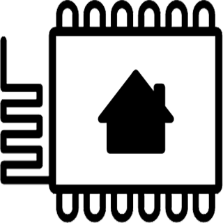
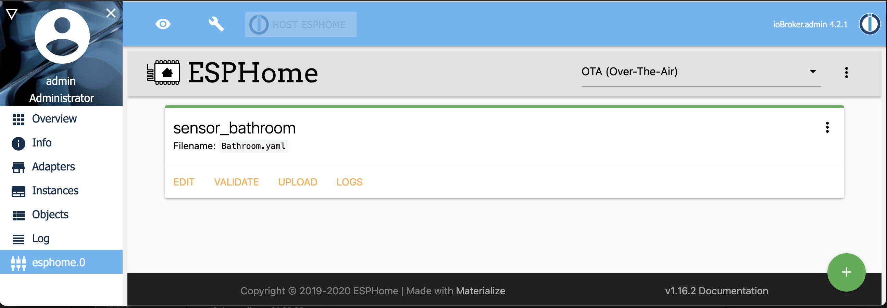
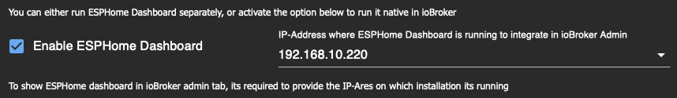
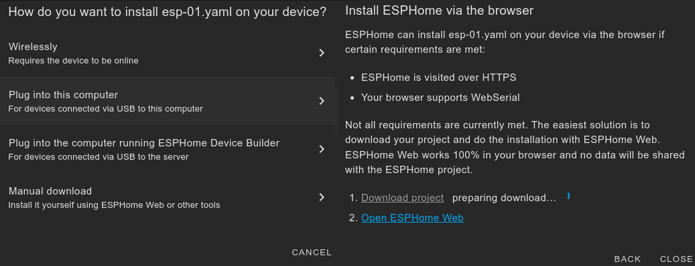
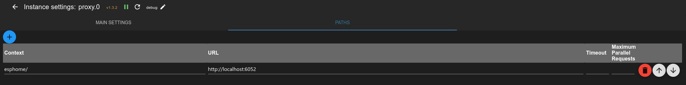
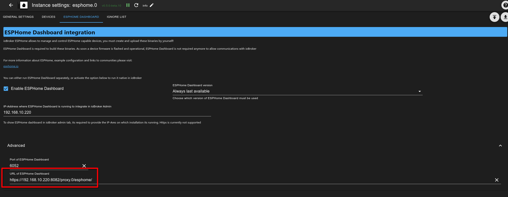
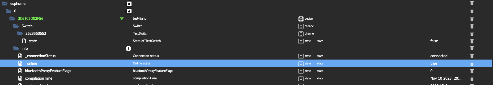

# ioBroker.esphome

[](https://www.npmjs.com/package/iobroker.esphome)
[](https://www.npmjs.com/package/iobroker.esphome)


[](https://david-dm.org/DrozmotiX/iobroker.esphome)
[](https://weblate.iobroker.net/engage/adapters/?utm_source=widget)
[](https://snyk.io/test/github/DrozmotiX/ioBroker.esphome)

[](https://nodei.co/npm/iobroker.esphome/)

**Tests:** 

**This adapter uses Sentry libraries to automatically report exceptions and code errors to the developers.** For more details and for information how to disable the error reporting see [Sentry-Plugin Documentation](https://github.com/ioBroker/plugin-sentry#plugin-sentry)! Sentry reporting is used starting with js-controller 3.0.

## ESPHome adapter for ioBroker

Control your ESP8266/ESP32 with simple yet powerful configuration files created and managed by ESPHome.
Native integration of ESPHome managed device (Including Dashboard) by its native API and ensures all data is synchronized (live-event handling, no data polling ! :)



**Quick Links:**

- 📋 [FAQ - Common Questions](#frequently-asked-questions-faq)
- ⚙️ [Prerequisites & Setup](#prerequisites)
- 🎛️ [Dashboard Integration](#esphome-dashboard-integration-optional)
- 📱 [Device Management](#device-management)
- 🔧 [Configuration Examples](#example-config)

This adapter uses the [esphome-native-api](https://github.com/twocolors/esphome-native-api#readme) with all credits to @twocolors to interact with [ESPHome API](https://esphome.io/components/api.html?highlight=api)!

## Frequently Asked Questions (FAQ)

### What's the difference between the ioBroker ESPHome Adapter and ESPHome Dashboard?

**ioBroker ESPHome Adapter:**

- Integrates your ESPHome devices into ioBroker for home automation control
- Communicates directly with ESP devices via ESPHome's native API
- Creates ioBroker states/objects for device control and monitoring
- Handles real-time device status updates (no polling required)
- Manages device configuration within ioBroker

**ESPHome Dashboard:**

- A web interface for creating, editing, and managing ESPHome device configurations
- Used for writing YAML configs, compiling firmware, and flashing devices
- Can be integrated into ioBroker's admin interface as an optional feature
- Can be run either integrated with this adapter or as an external installation (Docker, standalone)

**In Summary:** The adapter controls your devices within ioBroker, while the dashboard manages device configurations and firmware.

### How do I configure the Dashboard IP selector?

The Dashboard IP setting in the adapter configuration serves different purposes:

**For Integrated Dashboard Tab in ioBroker Admin:**

1. Enter the IP address and port where your ESPHome Dashboard is running
2. **Built-in Dashboard:** Use the IP address of your ioBroker host (e.g., `192.168.1.10:6052`)
    - **Important:** Do NOT use `127.0.0.1:6052` (nor `localhost:6052`) if you access ioBroker from other devices - the iframe will try to reach 127.0.0.1 from the client's browser, not the ioBroker server
    - Only use `127.0.0.1:6052` if you ONLY access ioBroker admin from the same machine where ioBroker is running
3. **External Dashboard:** Use the IP:port of your external ESPHome installation (e.g., `192.168.1.100:6052`)
4. **HTTPS Setup:** For HTTPS environments, see the detailed HTTPS configuration section below

**Dashboard IP Examples:**

- Built-in (accessed from network): `192.168.1.10:6052` (replace with your ioBroker host IP)
- Built-in (local only): `127.0.0.1:6052` (only if admin accessed on same machine)
- External Host: `esphome.local:6052` or `192.168.1.100:6052`
- HTTPS Proxy: `https://192.168.1.50:8082/proxy.0/esphome/`



**Dashboard tab:** The integrated dashboard needs some time to start, installing ESPHome takes several minutes on the first start or after a version change. Until it answers, the tab shows a hint and the start log instead of an empty page and then switches to the dashboard by itself, there is no need to reload the page or restart the instance (admin 8.0.12 or newer).

**Note:** You can use this adapter to control ESPHome devices without configuring the Dashboard IP. The Dashboard IP is only needed if you want to integrate the ESPHome Dashboard interface into ioBroker's admin panel.

### Do I need the ESPHome Dashboard to use this adapter?

**No, the Dashboard is optional.** You can use this adapter in several ways:

1. **Adapter Only:** Control pre-configured ESPHome devices without any dashboard integration
2. **Adapter + External Dashboard:** Use your existing ESPHome installation (Docker, standalone) and optionally integrate it into ioBroker's interface
3. **Adapter + Built-in Dashboard:** Enable the integrated ESPHome Dashboard feature for a complete solution

The adapter works independently and only requires devices with ESPHome API enabled in their configuration.

### How do I add devices to the adapter?

1. **Ensure ESPHome API is enabled** in your device's YAML configuration (see Prerequisites section)
2. **Open the adapter's device tab** in ioBroker Admin (adapter must be running)
3. **Add devices manually:** Enter device IP address and authentication credentials
4. **Automatic discovery:** Use the autodiscovery feature if enabled in adapter settings

The adapter will establish a connection and create all necessary ioBroker objects for device control.

### I configured a device in the ESPHome Dashboard, but it doesn't show up in the adapter

**Important:** The adapter and dashboard are completely separate components with no automatic integration. The adapter can optionally install (and start) the dashboard for you, just for convenience. Again, this does not mean there is any integration between them.

- **Dashboard:** Used for creating/editing YAML configs, compiling firmware, and flashing devices
- **Adapter:** Used for controlling devices and synchronizing their state with ioBroker

**To make a dashboard-configured device work with the adapter:**

1. Flash the device with the configuration from the dashboard (ensure ESPHome API is enabled in YAML)
2. Manually add the device in the adapter settings (device tab). Enter IP/hostname and encryption key (recommended) or password (legacy)
3. The adapter will then connect to the device via ESPHome's native API

**Note:** Future tighter integration between dashboard and adapter may be implemented (see issue #228), but currently they operate independently.

### I configured a device in the adapter, but it doesn't show up in the dashboard

**This is expected behavior** - the adapter and dashboard do not automatically sync device configurations.

- The **adapter** connects to devices via ESPHome's native API for control/monitoring
- The **dashboard** manages YAML configurations and firmware compilation

**If you want the device in the dashboard:**

**Option 1:**

1. The ESPHome Dashboard can discover devices in the same network automatically
2. In the dashboard, discovered devices will show with an "ADOPT" button
3. Click "ADOPT" to add them to your dashboard for configuration management

**Option 2:**

- Create a new device in the dashboard and copy your existing yaml into there.

**Note:** You don't need devices in the dashboard if you only want to control them via ioBroker. The dashboard is only needed for creating/modifying device configurations.

### How do I install / update Python

TLDR: You don't!

The adapter does not care about your system's python installation. It will install and create its own python environment with the correct versions anyway. So please don't mess around with python commands on your system if you don't know what you are doing.

### What does the "Reset Python environment" button do?

The built-in ESPHome Dashboard runs in its own Python environment, which the adapter sets up with [autopy](https://github.com/tweaselORG/autopy). autopy stores it in its cache directory, which depends on the platform (in the home directory of the user running ioBroker):

- Linux: `~/.cache/autopy` (usually `/home/iobroker/.cache/autopy`), or `$XDG_CACHE_HOME/autopy` if `XDG_CACHE_HOME` is set
- macOS: `~/Library/Caches/autopy`
- Windows: `%LOCALAPPDATA%\autopy\Cache`

In there, `python/` holds the Python version downloaded by autopy and `venv/esphome/` the virtual environment with ESPHome, ESPHome Device Builder, Pillow and their dependencies.

The button "Reset Python environment" (adapter settings, ESPHome Dashboard tab, only shown while the instance is running) removes the virtual environment `venv/esphome/`. The downloaded Python is kept. The state `esphome.X.info.clearAutopyCache` does the same, for example from a script (its id is kept from the former "Clear Autopy Cache" button).

**When to use it:** only when the built-in dashboard does not start or does not load, and the log points to a broken Python environment, for example:

- `"esphome" is missing in the Python environment` or `spawn esphome ENOENT`
- pip errors or a dashboard that stops right after the start, after an interrupted installation (adapter stopped, power loss, full disk) or an update of ESPHome / Pillow that went wrong

It is not needed to change the ESPHome version: the adapter updates the environment on every start.

**What happens:**

1. Restart the adapter instance after the reset. The running dashboard keeps using the removed files until then and may fail.
2. On the next start the adapter installs ESPHome and its dependencies again. This takes several minutes (longer on a Raspberry Pi) and needs internet access, the dashboard is not available until it is finished. Follow the progress in the log.

Your device configurations (YAML files) are **not** affected, they are stored in the ioBroker data directory, not in the Python environment. Devices connected to the adapter keep working, only the dashboard is affected.

If the downloaded Python itself is broken (rare, e.g. an interrupted download), stop the adapter and delete the whole autopy cache directory listed above by hand.

<!--
## [Documentation](https://DrozmotiX.github.io/languages/en/Adapter/ESPHome/)

All our adapter documentation can be found at [The DrozmotiX Docu Page](https://DrozmotiX.github.io/languages/en/Adapter/ESPHome/)
-->

## Prerequisites

    * NodeJS >= 22.12
    * API is activated in YAML
    * For admin tabs (optional)
        * ESPHome Dashboard IP is provided in instance settings

## Testing pre-releases

Pre-releases are published to npm under the `next` dist-tag and are **not** offered by the
ioBroker repository - they have to be installed explicitly. Feedback on a beta is very welcome,
please report anything you find in the [issue tracker](https://github.com/DrozmotiX/ioBroker.esphome/issues).

Install the current pre-release from the ioBroker host:

```bash
iobroker url iobroker.esphome@next
```

Or install one specific version:

```bash
iobroker url iobroker.esphome@1.0.0-beta.1
```

To go back to the released version afterwards:

```bash
iobroker url iobroker.esphome
```

Every pre-release is also listed under
[Releases](https://github.com/DrozmotiX/ioBroker.esphome/releases) with its changelog.

## ESPHome Dashboard Integration (Optional)

This adapter can optionally integrate the ESPHome Dashboard into ioBroker's admin interface. You have several options:

**Option 1: Built-in Dashboard (Recommended for beginners)**

- Enable "Native Integration of ESPHome Dashboard" in adapter settings
- Uses integrated Python environment (no external setup required)
- Dashboard runs on port 6052 by default
- Set Dashboard IP to `127.0.0.1:6052` for admin integration

**Option 1b: Built-in Dashboard in Docker (beta)**

- Beta: the option "Use Docker Integration (Beta)" is only shown in the expert mode of admin. Enable the expert mode, then the dashboard
  and "Use Docker Integration" in the "ESPHome Dashboard" tab of the adapter settings. To switch it off again, the expert mode is needed as well
- Instead of a Python environment, the dashboard runs in the official ESPHome container (`ghcr.io/esphome/esphome`),
  started and stopped together with the instance by the [docker plugin of ioBroker](https://github.com/ioBroker/plugin-docker)
- Requires Docker on the ioBroker host (the checkbox is only available when Docker is found), not available e.g. on Windows without Docker.
  In a multihost installation the checkbox checks Docker on the host of the admin instance showing the settings, which is not
  necessarily the host of the ESPHome instance: the log of the instance reports when Docker is missing there
- The image tag is the selected ESPHome Dashboard version ("Always last available" uses the newest ESPHome release, which can be a beta).
  Only when no version is known at all (no release list from GitHub, nothing cached), the `stable` image is used and pulled again on every start.
  The Pillow and ESPHome Device Builder versions are not used, the image brings its own
- The container uses the host network (needed for the online status of the devices) and the port configured in the advanced settings.
  Docker Desktop (Windows, macOS) does not support the host network by default, use a Linux host or the dashboard without Docker there
- While the instance runs, a stopped container is started again within a minute. Docker itself does not restart it, e.g. after a reboot
  it only runs once the instance starts it. When the instance starts without "Use Docker Integration" (or with the dashboard disabled),
  a container it left behind is removed
- The YAML files stay in `iobroker-data/esphome.<instance>`, the same directory as without Docker. When ioBroker itself runs in
  a container, this path has to exist on the Docker host as well
- PlatformIO, ESP-IDF and the other toolchains needed to compile (several GB) are kept in the Docker volume
  `iob_esphome_<instance>_esphome_cache`, not in `iobroker-data`. It stays when Docker Integration is disabled, remove it with
  `docker volume rm iob_esphome_<instance>_esphome_cache` if you do not need it any more
- The dashboard in the container runs as the user of the ioBroker instance, so the YAML files and build directories it creates belong
  to that user, like those of the dashboard without Docker. Files an earlier version left behind as `root` are handed over at the next
  start of the container. Only when ioBroker itself runs as `root`, on Windows, or with rootless Docker, the container keeps running as its `root`
- The container gets the time zone of the ioBroker host (`TZ`): ESPHome compiles the time zone of the system it runs on into a device
  with a `time:` component but no `timezone:`, which would be UTC in a container

**Option 2: External Dashboard**

- Use existing ESPHome installation (Docker, standalone, etc.)
- Enter the external dashboard's IP:port in adapter settings
- Example: `192.168.1.100:6052` for Docker container

**Option 3: No Dashboard Integration**

- Skip dashboard configuration entirely
- Use external ESPHome tools for device configuration
- Adapter still controls devices normally


> **💡 See FAQ above** for detailed explanations about Dashboard IP configuration and adapter vs. dashboard differences.

### Using HTTPS

One reason to use HTTPS is to be able to flash directly to devices plugged into you pc, because esphome will not allow this with http (probably browser limitation with WebSerial).



Using the integrated dashboard when the iobroker is using https currently requires some more steps:

1. install - if you don't have it already - web adapter and configure https. see web documentation for further information: [ioBroker.web](https://github.com/ioBroker/ioBroker.web)
2. install [proxy](https://github.com/ioBroker/ioBroker.proxy) adapter
3. configure the path in the proxy adapter settings:
    1. context: `esphome/`
    2. url: `http://localhost:6052`
       
4. configure the full dashboard url in the advanced section of the esphome adapter settings - esphome dashboard:
    1. like: `https://<iobrokerIP>:<webAdapterPort>/proxy.0/esphome/`
    2. where `<iobrokerIP>` is the ip of the host where you iobroker is running (same as above)
    3. and `<webAdapterPort>` is the port of the web adapter (default is 8082)
    4. it should look something like this:
       
    5. if you run the dashboard on an external host, you can also use the url to an external dashboard instance here

## How to use this adapter

### Activate API in YAML

> [!IMPORTANT]
> ioBroker ESPHome allows to integrate Devices by Encryption Key (recommended) or API-Password (legacy),
> you must specify your authentication settings accordingly,
> see [ESPHome Documentation](https://esphome.io/components/api.html?highlight=api)
> Please only configure Encryption Key (preferable) or API-Password (legacy)

#### Example Encryption Key configuration entry

```
api:
  encryption:
    key: "DyDfEgDzmA9GlK6ZuLkj3qgFcjXiZUzUf4chnIcjQto="
```

#### Example API configuration entry

```
api:
  password: 'MyPassword'
```

## Device Management

### Add / Modify / Remove ESPHome devices to ioBroker

> [!IMPORTANT]
> This adapter integrates communication with ESPHome capable devices and
> (if activated) an integrated version of ESPHome Dashboard.
> You must configure and upload your ESP configuration by yourself,
> either by using the integrated Dashboard or an external alternative
> (like Docker) before they can be integrated to ioBroker

> **💡 See FAQ above** for step-by-step guidance on adding devices to the adapter.

Devices are managed in the ioBroker device manager, shown as the second tab ("Devices") of the adapter
settings and in the "Devices" tab of admin. It lists all known devices with their connection status and, when auto discovery
is enabled, the devices found on the network that are not added yet.

> [!NOTE]
> The device manager is only available while the adapter is running.

The card of a device shows its Wi-Fi signal strength (RSSI) when the device has a
[`wifi_signal`](https://esphome.io/components/sensor/wifi_signal.html) sensor in dBm (the default unit):

```
sensor:
  - platform: wifi_signal
    name: "WiFi Signal"
    update_interval: 60s
```

- Add device
    - Enter the IP address and the encryption key (or API password of older firmware) of the device,
      the adapter connects and reports whether the connection succeeded
    - Discovered devices that are not added yet have a grey header and are marked "Not added" instead of
      showing a connection status. They are added with their "Add" button, the IP address is filled in already
- Change connection settings
    - Enter new credentials, leave both fields empty to keep the current ones
    - When an encryption Key is provided, API-Password is ignored, please ensure proper YAML configuration!
- Delete device
    - Removes the device after confirmation

> [!WARNING]
> Deleting a device removes it and all its related states from ioBroker!

If connection was successfully, the Device will be initiated and all related states created to control their attributes.  
When making any changes to your YAML configuration, reboot of the ESP will disconnect and initiate a new connection.  
During this process, states not part anymore of YAML configuration will be automatically removed.



### YAML File Management

The adapter provides a convenient interface for managing YAML configuration files directly from the admin UI. This feature allows you to upload, download, and manage YAML files that are stored in the ESPHome directory and can be used by the ESPHome Dashboard.

#### Features

- **Upload YAML Files**: Paste your YAML configuration content directly into the admin interface and upload it to the ESPHome directory
- **View File List**: See all YAML files currently stored in the ESPHome directory with file size and modification date
- **Edit Files**: Load the content of any YAML file into the editor, change it and upload it again
- **Delete Files**: Remove YAML files that are no longer needed

#### How to Use

The adapter instance must be running, the tab shows a note otherwise.

1. **Navigate to the "YAML Files" tab** in the adapter configuration, the file list is loaded automatically
   ("Refresh File List" reloads it, e.g. after files were changed in the ESPHome Dashboard)
2. **Upload a new file**:
    - Enter a filename (must end with .yaml or .yml)
    - Paste your YAML configuration content
    - Click "Upload File". An existing file with the same name is overwritten
3. **Edit or delete a file**:
    - Pick the file in the "YAML file" dropdown
    - Click "Open in Editor" to load it into the upload fields, change it and click "Upload File" to save it,
      or click "Delete File" to remove it

The filename and content fields are only used to transfer files, they are not stored in the adapter settings.

> [!NOTE]
> Files are stored in the ESPHome directory: `/opt/iobroker/iobroker-data/esphome.<instance>/`
>
> This is the same directory used by the ESPHome Dashboard, so files uploaded through the adapter
> are immediately available in the Dashboard and vice versa.

> [!TIP]
> This feature is particularly useful when:
>
> - You want to quickly edit configurations without accessing the server file system
> - You need to backup or share device configurations
> - You want to manage YAML files without running the full ESPHome Dashboard

### Example config

Example config, for more examples see [The DrozmotiX Docu Page](https://DrozmotiX.github.io) or [ESPHome Documentation](https://esphome.io/index.html)

<details><summary>Show example config
</summary>

    esphome:
      name: sensor_badkamer
      platform: ESP32
      board: esp-wrover-kit

    wifi:
      use_address: 192.168.10.122
      ssid: "xxxxx"
      password: "xxxxxx"

    # Enable ESPHome API
    api:
        password: 'MyPassword'
    # Activate i2c bus
    i2c:
      sda: 21
      scl: 22
      scan: True
      id: bus_a

    # Example configuration for bh1750
    sensor:
      - platform: bh1750
        name: "Hal_Illuminance"
        address: 0x23
        measurement_time: 69
        update_interval: 10s

    # Example configuration for an GPIO output
    output:
      - platform: gpio
        pin: 12
        inverted: true
        id: gpio_12

    # Example configuration linking a switch to the previous defined output
    switch:
      - platform: output
        name: "Generic Output"
        output: 'gpio_12'

</details>

## Controlling RGBW Lights

### RGB vs RGBW — What's the Difference?

**RGB lights** use three channels (red, green, blue) to produce colours, including white by mixing all three at maximum. **RGBW lights** add a dedicated fourth white channel (`white`) that provides a cleaner, brighter white than mixing RGB.

### Available states for a light entity

| State                    | Description                                                                                                                                                                                           |
| ------------------------ | ----------------------------------------------------------------------------------------------------------------------------------------------------------------------------------------------------- |
| `colorHEX`               | Writable hex colour string, e.g. `#ff6600`. Writing here updates red/green/blue and sends the command.                                                                                                |
| `red` / `green` / `blue` | Individual colour channels (0 – 255).                                                                                                                                                                 |
| `white`                  | Dedicated white channel (0 – 255). Only present on RGBW-capable lights.                                                                                                                               |
| `brightness`             | Overall brightness (0 – 255).                                                                                                                                                                         |
| `config.rgbAutoWhite`    | **RGBW only** — when set to `true`, writing `#ffffff` to `colorHEX` automatically activates the white channel and sets RGB to zero. Writing any other colour disables the white channel and uses RGB. |

### Auto white-channel switching (`rgbAutoWhite`)

When an RGBW-capable light is detected (i.e. it exposes a `white` state), the adapter automatically creates a writable `config.rgbAutoWhite` toggle state for that entity. It defaults to `false` (disabled).

**To enable:**

1. Open the ioBroker **Objects** view and navigate to your light entity, e.g. `esphome.0.MyLight.Light.1.config.rgbAutoWhite`.
2. Set the value to `true`.

**Behaviour when enabled:**

| `colorHEX` input | Result                                             |
| ---------------- | -------------------------------------------------- |
| `#ffffff`        | `white` → 1 (full), `red` / `green` / `blue` → 0   |
| Any other colour | `white` → 0, RGB channels set to the colour values |

**Behaviour when disabled (default):** the `white` channel is never touched automatically; users control it independently.

## Tasmota / ESPEasy migration

Migrating from previous Sonoff Tasmota or ESPEasy setups is very easy. You just need to have ESPHome create a binary for you and then upload that in the web interface.  
See for more details on our [Docu Page](https://DrozmotiX.github.io/languages/en/Adapter/ESPHome/06.migration.html)

**_NOTE:_** Generated yaml files are stored at ```/opt/iobroker/iobroker-data/iobroker.esphome.>instance</>device<.yaml

## Support me

If you like my work, please consider a personal donation  
(this is a personal Donate link for DutchmanNL, no relation to the ioBroker Project !)  
[](http://paypal.me/DutchmanNL)

## Changelog

<!--
    Placeholder for the next version (at the beginning of the line):
    ### __WORK IN PROGRESS__
    * (DutchmanNL)
-->

### **WORK IN PROGRESS**

- (@SimonFischer04) **ENHANCED**: Docker Integration: the dashboard in the container runs as the user of the ioBroker instance instead of `root`. The YAML files and build directories it creates can then be changed by the YAML file management and used by the dashboard without Docker; files left behind as `root` are handed over at the next start of the container
- (@SimonFischer04) **FIXED**: Docker Integration: devices with a `time:` component but no `timezone:` were compiled with UTC, the container now gets the time zone of the ioBroker host
- (@SimonFischer04) **FIXED**: YAML file management: a file the adapter may not write, e.g. created by a dashboard container as `root`, is replaced on upload instead of failing with "permission denied"
- (@SimonFischer04) **ENHANCED**: `@iobroker/plugin-docker` 1.3.1: a Docker daemon that accepts connections but does not answer no longer blocks the start of the instance
- (@SimonFischer04) **ENHANCED**: The ESPHome Dashboard tab of admin waits for the dashboard: while it starts (installing ESPHome takes several minutes on the first start or after a version change), the tab shows a hint and the start log, and switches to the dashboard by itself as soon as it answers. It also tells when the dashboard is disabled, could not be started or the instance is not running. The status is in the states `_ESPHomeDashboard.status` and `_ESPHomeDashboard.startLog`. Needs admin 8.0.12 or newer, older versions show the dashboard with a hint to wait
- (@SimonFischer04) **NEW**: The Python version of the ESPHome Dashboard environment can be selected in the advanced dashboard settings, a version (e.g. `3.13.2`) or a range (e.g. `3.12` for the newest 3.12.x). The default stays Python 3.13.2. Changing it creates the Python environment again on the next start
- (@SimonFischer04) **FIXED**: Newer Python versions can be downloaded again: autopy 1.3.1 reads the `SHA256SUMS` checksum file of newer python-build-standalone releases
- (@SimonFischer04) **NEW**: Optional login for the ESPHome Dashboard (username and password in the advanced dashboard settings, the password is stored encrypted). Without both, the dashboard stays unprotected as before. Works for the dashboard process and the Docker Integration
- (@SimonFischer04) **NEW**: Any ESPHome Dashboard version can be typed into the version field of the adapter configuration, e.g. a beta release or a version not (yet) in the list
- (@SimonFischer04) **ENHANCED**: Devices can be added by host name (e.g. `kitchen.local`) or IPv6 address, the device manager no longer only accepts IPv4 addresses
- (@SimonFischer04) **ENHANCED**: The address field of the ESPHome Dashboard also suggests the IPv6 addresses of the host, an IPv6 address is put in brackets in the dashboard URL
- (@SimonFischer04) **ENHANCED**: The listening address of the auto discovery can be an IPv6 address, the discovery then listens for devices on the network interface of this address. Devices announcing only an IPv6 address are discovered as well
- (@SimonFischer04) **ENHANCED**: `info.connection` lists the connected devices by name (comma-separated, like the sonoff and miner adapters do) instead of always being `true`. The admin shows the instance green while at least one device is connected and shows which ones, an instance without a connected device is shown yellow
- (@SimonFischer04) **FIXED**: The "Clear Autopy Cache" button did nothing on macOS, on Windows and on Linux with `XDG_CACHE_HOME` set: it always deleted `~/.cache/autopy`, autopy stores its files elsewhere there. The button is renamed to "Reset Python environment" and removes the Python environment of the dashboard through autopy now, wherever autopy stores it. The downloaded Python is kept, so the reinstallation is faster
- (@SimonFischer04) **ENHANCED**: README: FAQ entry explaining the "Reset Python environment" button, when to use it and what happens afterwards
- (@SimonFischer04) **FIXED**: ESPHome Dashboard versions 2026.7.0 and newer work again (#479). ESPHome removed the built-in dashboard in 2026.7.0, from this version on ESPHome Device Builder is installed and started in its place, by default in the newest version supporting the selected ESPHome version. Pillow is no longer installed separately: ESPHome installs the version it requires itself, a different selected version made the installation fail. The Pillow version is set to "Auto Detect" once
- (@SimonFischer04) **NEW**: The Pillow and ESPHome Device Builder versions can be selected in the "Advanced" section of the dashboard settings, "Auto Detect" (default) leaves them to ESPHome and pip
- (@SimonFischer04) **FIXED**: The adapter no longer terminates when the ESPHome Dashboard cannot be started (`spawn esphome ENOENT`), an error with the reason is logged instead. Errors of the dashboard, like the reason why it stops right after the start, are logged as well
- (@SimonFischer04) **ENHANCED**: With the ESPHome Dashboard enabled, the instance only shows green once the dashboard is reachable, `info.connection` lists no devices before that and again when the dashboard stops or cannot be installed
- (@copilot) **NEW**: Beta: the integrated ESPHome Dashboard can run in the official ESPHome Docker container instead of a Python environment, enable "Use Docker Integration (Beta)" in the ESPHome Dashboard settings (expert mode only). Requires Docker on the ioBroker host (#493)
- (@SimonFischer04) **ENHANCED**: With js-controller 8, the port of the ESPHome Dashboard is registered as used by the instance, a warning is logged when another instance holds it
- (@SimonFischer04) **FIXED**: Discovered devices show their MAC address with ":" separators again
- (@SimonFischer04) **NEW**: Support for the ioBroker device manager (#203). ESPHome devices are listed with their online status and details, can be added, adopted after discovery, given new credentials and deleted there
- (@SimonFischer04) **NEW**: The device manager shows the Wi-Fi signal strength (RSSI) of devices with a `wifi_signal` sensor
- (@SimonFischer04) **BREAKING**: The device tables and the add / delete buttons were removed from the adapter settings. The device manager is shown in their place as the second tab ("Devices") of the adapter settings, the discovery settings and the ignore list (previously its own tab) moved to a section "Discovery" of the main settings, where the listening address and the ignore list are only shown while device discovery is enabled, followed by a section "Connection behavior for known devices" with the configuration states, reconnect and ping settings
- (@SimonFischer04) **BREAKING**: Requires admin 7.8.20 or newer, the first version with the current device manager
- (@SimonFischer04) **BREAKING**: Removed the default credentials (encryption key and API password) from the main settings. They have not been used since version 0.6, when discovered devices stopped being connected automatically. Settings no longer used are removed from the instance configuration once, the adapter restarts after that
- (@SimonFischer04) **ENHANCED**: Moved all code for the integrated ESPHome Dashboard into its own module, no change in behavior
- (@SimonFischer04) **ENHANCED**: Removed the fallback to the ws package for compiling and flashing with the ESPHome Dashboard, the adapter always uses the WebSocket support built into Node.js 22 now, and ws is no longer installed with the adapter
- (@SimonFischer04) **ENHANCED**: Removed unused code for newly discovered devices
- (@SimonFischer04) **ENHANCED**: The log message when the ESPHome Dashboard starts shows the ESPHome and Pillow version used
- (@SimonFischer04) **FIXED**: When the ESPHome Dashboard stops, the log shows its exit code and signal. A handler that was meant to log them listened to an event the dashboard process never sends
- (@SimonFischer04) **FIXED**: The debug log for rounded values showed "[object Object]" instead of the entity name
- (@SimonFischer04) **FIXED**: Known devices were listed as "undefined" in the device table until they connected, because the device name was not stored in the device object any more
- (@SimonFischer04) **FIXED**: YAML file management works again (fixes #419). The file list loads when the "YAML Files" tab is opened, files are picked from a dropdown, "Open in Editor" loads a file into the upload fields, and uploading YAML with several lines no longer fails with "Filename and content are required". The upload fields are no longer stored in the adapter settings
- **FIXED**: The YAML Files tab still listed no files after that rewrite (#419). `getYamlFileList` called `I18n.translate()` before `I18n.init()` had finished (it is started in `onReady` and not awaited), the throw was answered as `{ error }` and json-config `textSendTo` stayed empty. The list now falls back to the English key, builds `{dataDir}/esphome.{instance}` with `path.join`, and reloads when the instance becomes alive
- (@SimonFischer04) **FIXED**: The adapter requires Node.js 22.12 or newer. The ESPHome Dashboard could not start on Node.js 22.0 to 22.11, because the build loads the ESM-only autopy package with require(), which those versions do not support
- (@SimonFischer04) **ENHANCED**: Adapter rebuilt on the current create-adapter template and moved to TypeScript, all code is type checked now
- (@SimonFischer04) **FIXED**: Fan speed level could not be changed, current ESPHome reports `supportedSpeedCount` instead of `supportedSpeedLevels`, so `speedLevel` was created read-only
- (@SimonFischer04) **FIXED**: Cover position and tilt are 0-100 % in ioBroker but were sent to ESPHome unscaled (it expects 0-1), so any value above 1 % fully opened the cover
- (@SimonFischer04) **NEW**: End-to-end test workflow that builds a real ESPHome device with the host platform and tests the adapter against it
- (@Garfonso) **FIXED**: Brightness, RGB, white and colour temperature reached no light any more. The ColorMode values in supported_color_modes are the bitmasks from api.proto (RGB = 35), but they were compared against a 0..9 index, so every modern ESPHome light was treated as on/off only

### 1.0.0 (2026-09-26) - Public Stable Release

- (@arteck) **FIXED**: A device that drops while its entities are still being announced no longer throws "Not connected", the state subscription is left to the reconnect
- (@arteck) **FIXED**: A connection loss logs one "Connection destroyed" warning per device instead of one per entity
- (@DutchmanNL) **ENHANCED**: Updated @iobroker/testing to 6.2.2 and @iobroker/adapter-core to 3.4.3
- (@DutchmanNL) **ENHANCED**: Tests now cover Node.js 22, 24 and 26 and the websocket library ws was updated to 8.21.3

### 1.0.0-beta.2 (2026-07-30)

- (@SimonFischer04) **FIXED**: ESPHome Dashboard 2026.6.5 and Pillow 12.2.0 are used instead of the latest available release, the 2026.7.x releases currently fail to install (#463)
- (@SimonFischer04) **FIXED**: Installations still set to "Always last available" are migrated to those versions once, so an update no longer leaves behind a dashboard that cannot be installed (#463)
- (@SimonFischer04) **NEW**: Selecting "Always last available" again is respected, the migration runs only once and such a setup only gets a warning at startup (#463)
- (@DutchmanNL) **FIXED**: Falling back to the latest ESPHome or Pillow release no longer aborts the dashboard setup, the requirement was passed to pip without a version specifier
- (@DutchmanNL) **FIXED**: Added the missing "pingInterval" and "pingAttempts" defaults to io-package.json, they were only defined in the admin configuration
- (@DutchmanNL) **ENHANCED**: "npm run check" is free of type errors, so type regressions are visible again

### 1.0.0-beta.1 (2026-07-28)

- (@DutchmanNL) **FIXED**: Restored a green CI matrix, the dashboard integration tests no longer hang the test runner
- (@DutchmanNL) **FIXED**: Corrected the changelog entry in io-package.json so it matches the published version
- (@DutchmanNL) **FIXED**: Admin configuration is fully translated again, 29 texts were only available in English
- (@DutchmanNL) **FIXED**: YAML upload field renders as a proper multi-line text area again
- (@DutchmanNL) **ENHANCED**: Timers are now managed by the adapter, so they are always cleaned up on unload
- (@DutchmanNL) **ENHANCED**: Pre-releases are published under the npm "beta" tag instead of "latest"
- (@DutchmanNL) **ENHANCED**: Removed the obsolete admin/words.js and added prettier formatting scripts
- (@dependabot) **ENHANCED**: Updated @iobroker/testing to 5.3.0 and the GitHub actions used in CI

### 1.0.0-beta.0 - Stable version release candidate

- (@copilot) **NEW**: Promoted ioBroker.esphome to stable **v1.0.0**
- (@copilot) **NEW**: Brings ESPHome devices into ioBroker with live state updates and direct control
- (@copilot) **NEW**: Supports a wide range of device types including lights, switches, sensors, fans, covers, locks, and text entities
- (@copilot) **ENHANCED**: Includes optional ESPHome Dashboard integration plus built-in helpers for discovery and YAML-based device management
- (@arteck) **FIXED**: Improved disconnect handling and diagnostics so reconnects recover more cleanly when device connections are destroyed
- (@copilot) **ENHANCED**: Establishes a stable baseline for future ESPHome adapter development in ioBroker

### 0.7.0 (2026-05-17)

- (@SimonFischer04) **FIXED** copilot hallucinations
- (@SimonFischer04) **NEW** 'Always last available' for pillow version
- (@copilot) **FIXED**: Invalid jsonConfig warning on adapter installation
- (DutchmanNL) **FIXED**: ESLint errors by code refactoring

[Older changelogs can be found there](CHANGELOG_OLD.md)

## License

MIT License

Copyright (c) 2023-2026 DutchmanNL <rdrozda86@gmail.com>

Permission is hereby granted, free of charge, to any person obtaining a copy
of this software and associated documentation files (the "Software"), to deal
in the Software without restriction, including without limitation the rights
to use, copy, modify, merge, publish, distribute, sublicense, and/or sell
copies of the Software, and to permit persons to whom the Software is
furnished to do so, subject to the following conditions:

The above copyright notice and this permission notice shall be included in all
copies or substantial portions of the Software.

THE SOFTWARE IS PROVIDED "AS IS", WITHOUT WARRANTY OF ANY KIND, EXPRESS OR
IMPLIED, INCLUDING BUT NOT LIMITED TO THE WARRANTIES OF MERCHANTABILITY,
FITNESS FOR A PARTICULAR PURPOSE AND NONINFRINGEMENT. IN NO EVENT SHALL THE
AUTHORS OR COPYRIGHT HOLDERS BE LIABLE FOR ANY CLAIM, DAMAGES OR OTHER
LIABILITY, WHETHER IN AN ACTION OF CONTRACT, TORT OR OTHERWISE, ARISING FROM,
OUT OF OR IN CONNECTION WITH THE SOFTWARE OR THE USE OR OTHER DEALINGS IN THE
SOFTWARE.
